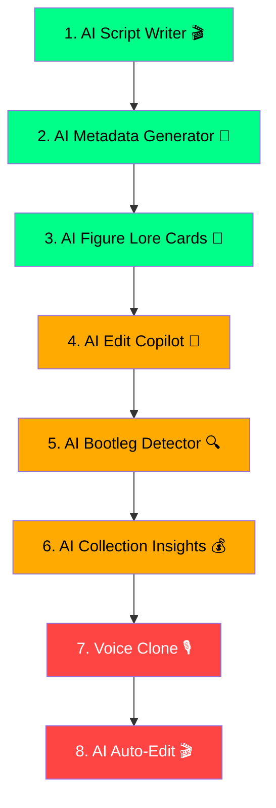

# 🤖 AI Strategy — Komic Freaks Studio

> **Goal:** Make AI the competitive moat that separates Komic Freaks from every other video editor and figure collector app.

---

## 📊 Current AI Inventory (Already Built)

| Feature | AI Engine | Side |
|---------|-----------|------|
| AI Auto-Cut (silence detection) | Web Audio API (local) | Video Editor |
| AI Narration (text-to-speech) | ElevenLabs API | Video Editor |
| Auto-Captions (speech-to-text) | OpenAI Whisper | Video Editor |
| AI Vocal Isolation | Demucs | Video Editor |
| Anime Clip Extractor | YouTube Audio API | Video Editor |

> [!NOTE]
> You already have **5 AI features** — but they're all audio/speech focused. The massive gap is **text intelligence** (GPT-powered) and **vision AI**. That's where the real magic lives.

---

## 🎯 Proposed AI Features — Ranked by Impact

### 🟢 Tier 1: Quick Wins (1–2 days each)

These use the OpenAI API key you already have configured (`VITE_OPENAI_API_KEY`).

---

#### 1. 🎬 AI Script Writer
**Side:** Video Editor → Narration Panel  
**What:** User picks a template (e.g., "Figure Review", "Unboxing", "Top 5") + enters the figure name → AI generates a full narration script in seconds.

**Why this is killer:** Your nephew currently has to *write* scripts before recording. This removes the hardest part of content creation. Script → ElevenLabs → Timeline. Full automation.

**Prompt example:**
```
Write a 60-second YouTube script for an SHF Figuarts unboxing video of "Son Goku Ultra Instinct".
Tone: Hype, anime fan energy. Include: first impressions, articulation highlights, comparison callout, final rating.
```

**API:** `gpt-4o-mini` (cheap, fast, good enough for scripts)  
**Cost:** ~$0.001 per script generation  
**Effort:** Small — add a "Generate Script" button to the existing Narration panel

---

#### 2. 📝 AI Video Metadata Generator
**Side:** Video Editor → Export Panel  
**What:** After export, AI generates an optimized YouTube title, description, tags, and hashtags based on the project name, template type, and narration script.

**Why:** SEO is the #1 growth lever for small YouTube channels. Nobody does it well manually.

**Output example:**
```
Title: S.H. Figuarts Ultra Instinct Goku REVIEW — Is This The BEST Dragon Ball Figure?!
Description: [300-word SEO-optimized description]
Tags: shfiguarts, dragon ball, ultra instinct goku, figure review, bandai...
Hashtags: #SHFiguarts #DragonBall #FigureReview
```

**API:** `gpt-4o-mini`  
**Cost:** ~$0.002 per generation  
**Effort:** Small — new section in Export modal

---

#### 3. 📖 AI Figure Lore Card (SHF Vault)
**Side:** Vault → Figure Detail  
**What:** Tap any figure → "AI Lore" button generates a character backstory card: origin story, first anime appearance, notable battles, power level, fun facts.

**Why:** Turns a boring inventory app into an **encyclopedia**. Collectors love trivia. This is the kind of feature that makes people show the app to their friends.

**API:** `gpt-4o-mini` with a system prompt seeded with Dragon Ball franchise knowledge  
**Cost:** ~$0.001 per card  
**Effort:** Small — add button to figure detail modal

---

### 🟡 Tier 2: Core Differentiators (3–5 days each)

---

#### 4. 🧠 AI Edit Assistant (Copilot Sidebar)
**Side:** Video Editor → New sidebar panel  
**What:** A persistent AI chat panel inside the editor. User can ask:
- *"Make the intro more dramatic"* → suggests transitions, SFX, and music
- *"Cut this down to 60 seconds"* → analyzes timeline and suggests cuts
- *"Add captions to the narration"* → triggers the auto-caption flow
- *"What SFX should I use here?"* → recommends from your library

**Why:** This is the **Copilot for video editing**. No other browser-based editor has this. It becomes the defining feature of Komic Freaks.

**Architecture:** GPT-4o with function calling — the AI can directly invoke your existing services:
```
Functions available to AI:
- addTransition(type, position)
- addSFX(sfxName, position)
- setClipSpeed(clipId, speed)
- addCaptions(trackId)
- generateNarration(script, voice)
```

**API:** `gpt-4o` (needs reasoning for complex editing suggestions)  
**Cost:** ~$0.01–0.03 per conversation turn  
**Effort:** Medium — needs function calling integration + chat UI

---

#### 5. 🎨 AI Thumbnail Generator (Enhanced)
**Side:** Video Editor → Thumbnail Panel  
**What:** You already have a thumbnail generator with presets. **Upgrade it** with:
- AI-generated background art (DALL-E 3 or your existing `generate_image` equivalent)
- AI text suggestions (clickbait-optimized titles)
- Auto-compose: AI picks the best frame from your video as the base

**API:** `gpt-4o` for text + `dall-e-3` for backgrounds  
**Cost:** ~$0.04 per thumbnail  
**Effort:** Medium — extend existing Thumbnail component

---

#### 6. 🔍 AI Bootleg Detector (SHF Vault)
**Side:** Vault → Camera/Upload  
**What:** User uploads a photo of a figure → Vision AI analyzes paint quality, joint type, box art, logos → returns a **Legit Score** (0–100%) with specific callouts.

**Why:** SHF is one of the **most bootlegged** action figure lines. This is a genuine $10/month premium feature. Collectors would pay for peace of mind.

**How it works:**
1. User uploads photo
2. `gpt-4o` Vision analyzes with a prompt like:
   ```
   Analyze this S.H. Figuarts action figure photo for authenticity.
   Check: paint quality, joint precision, logo placement, box art quality,
   color accuracy. Score 0-100 and explain any red flags.
   ```
3. Returns structured result with confidence score

**API:** `gpt-4o` (vision)  
**Cost:** ~$0.01–0.03 per scan  
**Effort:** Medium — camera/upload UI + vision API integration

---

#### 7. 💰 AI Collection Insights (SHF Vault)
**Side:** Vault → New "Insights" tab  
**What:** AI analyzes the user's entire collection and generates:
- **"Your collection at a glance"** — natural language summary
- **Investment advice** — "Your SS4 Gogeta has appreciated 340% since release"
- **Completion suggestions** — "You're 2 figures away from completing the Saiyan Saga set"
- **Sell recommendations** — "3 figures in your collection are at peak market value"

**API:** `gpt-4o-mini` (feed it the collection JSON)  
**Cost:** ~$0.005 per analysis  
**Effort:** Medium

---

### 🔴 Tier 3: Premium / Future (1–2 weeks each)

---

#### 8. 🎙️ AI Voice Clone
**Side:** Video Editor → Narration  
**What:** Clone your nephew's voice with ElevenLabs Voice Cloning. He records 30 seconds → the AI can narrate any script in *his* voice.

**Why:** Authentic creator branding. His channel literally sounds like him, even on days he can't record.

**API:** ElevenLabs Professional Voice Cloning  
**Cost:** Requires ElevenLabs paid plan (~$5/month starter)  
**Effort:** Small (API exists, just need upload UI)

---

#### 9. 📈 AI Price Predictor (SHF Vault)
**Side:** Vault → Figure Detail → "Price Forecast"  
**What:** Based on historical trends (release date, exclusivity, character popularity, recent anime releases), predict whether a figure's value will go up or down.

**Why:** Turns collectors into investors. Massive engagement hook.

**Requires:** Historical price data (Phase 2 dependency — needs the Triple-Source Pricing Engine first)

---

#### 10. 🎬 AI Auto-Edit
**Side:** Video Editor  
**What:** "One-Click Edit" — user imports raw footage → AI does everything:
1. Auto-cut silence (existing)
2. Auto-add transitions between cuts
3. Auto-add background music (picks from library based on mood)
4. Auto-add captions
5. Generates title card + outro

**Why:** The holy grail. Import → Export. Zero editing required.

**Effort:** Large — orchestration layer that chains existing services

---

#### 11. 🖼️ AI Smart B-Roll
**Side:** Video Editor  
**What:** AI detects when you're talking about a specific character/moment → auto-inserts relevant anime clips or images from your clip library.

**Requires:** Clip library tagging + scene understanding  
**Effort:** Large

---

#### 12. 🤝 AI Trade Advisor (SHF Vault)
**Side:** Vault → Marketplace (Phase 5)  
**What:** "Is this a good trade?" — user inputs two figures → AI compares market value, rarity, condition, and trend → recommends accept/decline.

**Requires:** Live pricing data  
**Effort:** Medium (once pricing engine exists)

---

## 🏗️ Architecture Decision

### API Routing Strategy

All AI calls should go through a **single service layer**:

```
src/services/
  aiService.js          ← NEW: Central AI orchestrator
  elevenlabs.js         ← Existing (TTS)
  whisperService.js     ← Existing (STT)
  autocut.js            ← Existing (silence detection)
```

**`aiService.js`** handles:
- API key management (reads from `VITE_OPENAI_API_KEY`)
- Rate limiting / usage tracking
- Response caching (save money on repeated queries)
- Function calling dispatch (for Edit Copilot)
- Error handling + fallbacks

### Cost Control

| Tier | Model | Cost per call | Monthly budget (100 calls/day) |
|------|-------|---------------|-------------------------------|
| Scripts, Metadata, Lore | `gpt-4o-mini` | ~$0.001 | ~$3/month |
| Edit Copilot, Vision | `gpt-4o` | ~$0.02 | ~$60/month |
| Thumbnails | `dall-e-3` | ~$0.04 | ~$120/month |
| Narration | ElevenLabs | ~$0.01 | Included in plan |

> [!TIP]
> Start with `gpt-4o-mini` for everything. Only upgrade to `gpt-4o` when you need vision or complex reasoning. The mini model is 20x cheaper and handles 90% of use cases.

---

## 🚀 Recommended Implementation Order



| # | Feature | Days | Depends On |
|---|---------|------|------------|
| 1 | AI Script Writer | 1 | Nothing (uses existing Narration panel) |
| 2 | AI Metadata Generator | 1 | Nothing (add to Export modal) |
| 3 | AI Figure Lore Cards | 1 | Nothing (add to Vault detail) |
| 4 | AI Edit Copilot | 3–5 | `aiService.js` foundation |
| 5 | AI Bootleg Detector | 3 | Vision API integration |
| 6 | AI Collection Insights | 2 | Vault data structure |
| 7 | Voice Clone | 1 | ElevenLabs paid plan |
| 8 | AI Auto-Edit | 5+ | All editing features complete |

---

## ❓ Decisions Needed From You

1. **Which features excite you most?** Pick your top 3 and I'll build them.
2. **Do you have an OpenAI API key active?** (I see `VITE_OPENAI_API_KEY` in the Whisper service — is it funded?)
3. **Budget tolerance?** The Tier 1 features cost pennies. Tier 2 (especially vision + DALL-E) can add up.
4. **Voice clone?** Does your nephew want his own AI voice? This is a game-changer for branding.
5. **Bootleg detector** — is this relevant to his collecting? If so, it's a premium feature people would pay for.
